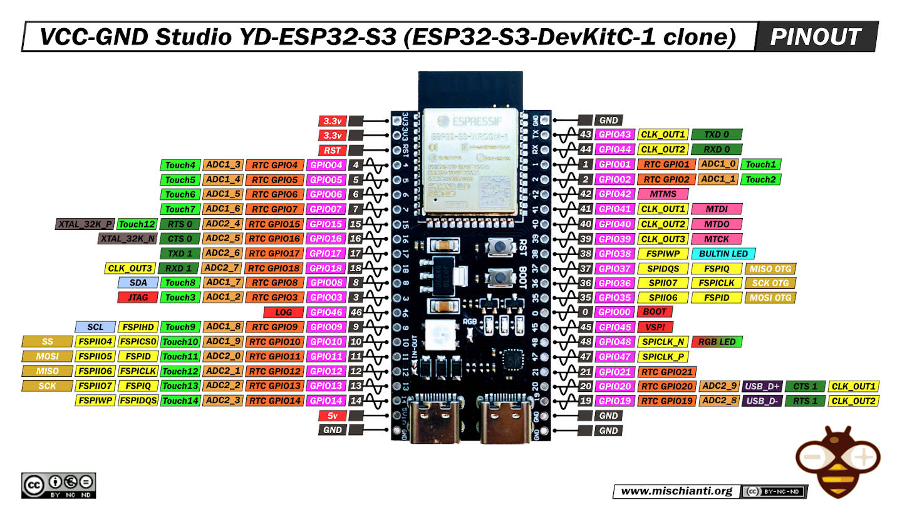
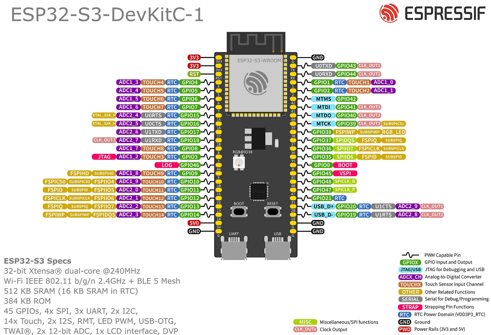

# SpectraFrame

A WiFi-enabled E-Paper display frame with web configuration, image upload, OTA updates, and hibernation features.

## Features

*   **Large E-Paper Display:** Utilizes a Waveshare 13.3inch E-Paper (E) display for high-resolution, low-power image display.
*   **Web Configuration:** Provides a simple web interface for initial WiFi setup and device configuration.
*   **Image Upload:** Allows users to upload custom images (specifically formatted for the 4bpp display) via the web interface.
*   **Over-The-Air (OTA) Updates:** Supports wireless firmware and filesystem updates directly from the web interface.
*   **Automatic Hibernation:** Enters a deep sleep mode after a period of inactivity to conserve power.
*   **Touch Wakeup:** Wakes from deep sleep via a configured touch pin (GPIO 4).
*   **LED Status Indicator:** A NeoPixel LED provides visual feedback on the device's current state (connecting, busy, idle, error, etc.).

## Hardware

*   **ESP32-S3 Microcontroller:** The core processing unit. The code is developed for ESP32-S3, specifically using the ESP32-S3-DevKitC-1 or similar.
*   **Waveshare 13.3inch E-Paper (E):** The display panel itself.
*   **Waveshare E-Paper Driver Board:** The specific driver board for the 13.3inch E-Paper (E), which handles the SPI communication and power management for the display. This board connects to the ESP32-S3 via SPI and GPIO pins.
*   **NeoPixel LED:** A single addressable RGB LED (WS2812B or compatible) connected to a configurable GPIO pin (default GPIO 48).
*   **Touch Sensor:** A touch-enabled GPIO pin (default GPIO 4) for waking the device from deep sleep.
*   **Power Supply:** A suitable 5V power supply for the ESP32-S3 and E-Paper driver board.

### Assembly Guide

_TODO_

### Wiring

| e-Paper Pin | Cable color | ESP32 Pin | Notes |
|---|---|---|---|
| VCC | Red | 3.3V | Alimentation principale de la carte. |
| GND | Black | GND | Référence de masse commune. |
| DIN | Blue | GPIO 11 (MOSI) | Ligne de données SPI de l'ESP32 vers l'écran. |
| CLK | Yellow | GPIO 12 (SCLK) | Ligne d'horloge du bus SPI. |
| CS_M | Orange | GPIO 10 (GPIO quelconque) | Chip Select pour le contrôleur de l'écran. |
| CS_S | Green | GPIO 9 (GPIO quelconque) | Chip Select pour la mémoire Flash intégrée. |
| DC | White | GPIO 8 (GPIO quelconque) | Sélection Données/Commande. |
| RST | Purple | GPIO 7 (GPIO quelconque) | Réinitialisation matérielle de l'écran. |
| BUSY | Brown | GPIO 6 (GPIO quelconque) | Signal "Occupé" de l'écran vers l'ESP32. Doit être une entrée. |
| PWR | Grey | GPIO 5 (GPIO quelconque) | Contrôle de l'alimentation interne de l'écran. |

Built in RGB led is on pin 48, the documentation is wrong. I also had to solder a jumper to enable it.

Pin 4 is ADC; used for battery monitoring via voltage divider.

https://github.com/rtek1000/YD-ESP32-23

 [source](https://docs.espressif.com/projects/esp-dev-kits/en/latest/esp32s3/esp32-s3-devkitc-1/user_guide.html#hardware-reference)

## Architecture

The software is structured around a main loop (`main.cpp`) and several manager classes, following an object-oriented approach to organize different functionalities.

*   **`main.cpp`:** Contains the core application setup (`setup()`) and main loop (`loop()`). It initializes peripherals, sets up WiFi (as either a STA or AP), starts the web server, manages the main application flow, handles touch input, and triggers hibernation. It orchestrates the interactions between the manager classes.
*   **`DisplayManager`:** Encapsulates all interactions with the E-Paper display hardware. It manages the display buffer, handles drawing operations (text, shapes, QR codes), and controls the display update and sleep cycles (`EPD_13IN3E_Init`, `EPD_13IN3E_Display`, `EPD_13IN3E_Sleep`). It also manages the state of what is currently shown on the display and persists this state across deep sleep cycles using `RTC_DATA_ATTR`.
*   **`HibernationManager`:** Manages the device's power-saving features. It tracks inactivity based on calls to `resetActivityTimer()`. When the inactivity timeout is reached, it triggers the deep sleep sequence by calling display sleep functions (`EPD_13IN3E_Sleep`, `DEV_Module_Exit`) and then initiating ESP32 deep sleep (`esp_deep_sleep_start`). It can be paused and resumed by other parts of the application (like during OTA or display updates).
*   **`OtaManager`:** Handles Over-The-Air firmware and filesystem updates. It provides the web server handler for `/api/update` and manages the `Update` process provided by the ESP32 core. It pauses hibernation during the update process and signals the LedManager for status feedback.
*   **`LedManager`:** Manages the NeoPixel LED status indicator. It encapsulates the FastLED library and provides a simple interface (`setMode()`, `update()`) to control the LED color and animation based on the application's state (busy, idle, error, AP mode, etc.).
*   **Web Server (`ESPAsyncWebServer`):** Handles incoming HTTP requests for serving the web UI, receiving configuration data, and accepting file uploads (images and OTA updates).
*   **DNS Server (`DNSServer`):** Used in AP mode to implement a captive portal, redirecting all DNS requests to the ESP32's IP address to ensure users are directed to the configuration web page.
*   **LittleFS:** The filesystem used to store the web UI files (`index.html`, `style.css`, `js/`) and the uploaded image file (`/image.bin`).
*   **DEV_Config:** Low-level hardware configuration and SPI communication functions for the E-Paper display, provided by the Waveshare library.

## User Manual

1.  **Initial Setup (AP Mode):**
    *   Power on the SpectraFrame.
    *   If no WiFi credentials are saved, the device will automatically start in Access Point (AP) mode.
    *   The E-Paper display will show a QR code containing the AP SSID (`SpectraFrameSetup`) and password (`spectra1234`). The LED will pulse green.
    *   Connect your phone or computer to this WiFi network.
    *   A captive portal should automatically redirect you to the configuration web page. If not, open a web browser and navigate to `http://192.168.4.1`.

2.  **Configuring WiFi (STA Mode):**
    *   On the configuration web page, enter your home/office WiFi SSID and password.
    *   Click "Save Configuration".
    *   The device will save the credentials and reboot.
    *   If the connection is successful, the device will connect to your WiFi network. The LED will pulse white when idle.
    *   If connection fails after reboot, it will revert to AP mode.

3.  **Accessing the Web Interface (STA Mode):**
    *   Once connected to your WiFi, the device's IP address will be displayed as a QR code on the E-Paper display (pulse white LED when idle).
    *   Scan the QR code or type the IP address into a web browser on a device connected to the *same* network.
    *   This will open the web interface where you can upload images and perform OTA updates.
    *   Touching the bottom right corner of the E-Paper display will also show the IP QR code temporarily.

4.  **Uploading an Image:**
    *   In the web interface, navigate to the image upload section.
    *   Select an image file. The web interface includes client-side JavaScript (`image-processor.js`) to resize and convert images to the correct 4bpp format (1200x1600 pixels, 4 colors: Black, White, Red, Yellow, Blue, Green).
    *   Click "Upload".
    *   The image will be uploaded to the device's internal storage (`/image.bin`).
    *   Upon successful upload, the new image will be displayed on the E-Paper, and the activity timer will be reset. The LED will briefly turn teal during the display update, then return to pulsing white.

5.  **Over-The-Air (OTA) Updates:**
    *   In the web interface, navigate to the OTA update section.
    *   Choose whether to update the "Firmware" or "Filesystem".
    *   Select the appropriate `.bin` file (either the firmware binary or a LittleFS image created with `mkspiffs` or `mklittlefs`).
    *   Click "Upload".
    *   The device will receive the update. The LED will pulse orange during the upload.
    *   Upon successful upload, the device will automatically reboot to apply the update. The LED will briefly turn green before rebooting.
    *   If the update fails, the LED will turn red, and an error message will be shown in the web interface.

6.  **Hibernation:**
    *   After 5 minutes of inactivity (no touch, no web requests, no image display), the device will automatically enter deep sleep mode to save power.
    *   The E-Paper display will show a message indicating it's sleeping, or revert to the last displayed image if one was set. The LED will turn off.
    *   To wake the device, touch the bottom right corner of the E-Paper display (GPIO 4).

7.  **LED Status Indicators:**
    *   **Off:** Deep sleep mode.
    *   **Pulsing Green:** AP Mode (waiting for configuration).
    *   **Pulsing White:** STA Mode, Idle (connected to WiFi, waiting for interaction).
    *   **Pulsing Orange:** Busy (performing an operation like file upload, display update, or OTA).
    *   **Static Teal:** Display is actively updating.
    *   **Static Green:** OTA Update successful (briefly before reboot).
    *   **Static Red:** Error occurred (e.g., failed to mount filesystem, failed OTA).

## Deploying LittleFS filesystem image

- in VS code go to PlatformIO panel and run Project Tasks > Build Filesystem Image
Kill all terminals or anything possibly keeping the COM port busy
- in PlatformIO panel, run Project Tasks > Upload Filesystem Image

## Further Development

*   Add more configuration options via the web UI (e.g., inactivity timeout, default display mode).
*   Implement different display modes (e.g., clock, weather, calendar integration).
*   Improve error handling and user feedback.
*   Optimize power consumption further.
*   Add security features (e.g., password protect web UI).

## Credits & dependencies

This project is made possible by:

*   Waveshare 13.3" Spectra6 E-Paper display [documentation](https://www.waveshare.com/wiki/13.3inch_e-Paper_HAT+_(E)_Manual) 
*   Web UI dithering tool was inspired from https://www.e-paper-display.com/dithering.html by Zhang Hui
*   Sources redistributed in this repository:
    *   Waveshare driver code from https://files.waveshare.com/wiki/13.3inch%20e-Paper%20HAT%2B/13.3inch_e-Paper_E.zip (`DEV_Config.*`, `EPD_13in3e.*`, `GUI_Paint.*`, `fonts.*`) - with small tweaks
    *  [QR Code generator](https://github.com/nayuki/QR-Code-generator) (`qrcodegen.hpp`) by Nayuki
*   Dependencies managed from ` platformio.ini`:
    *   [FastLED](https://github.com/FastLED/FastLED) 
    *   [ESPAsyncWebServer](https://github.com/ESP32Async/ESPAsyncWebServer)
    *   [ArduinoJson](https://github.com/bblanchon/ArduinoJson) by Benjamin Blanchon
