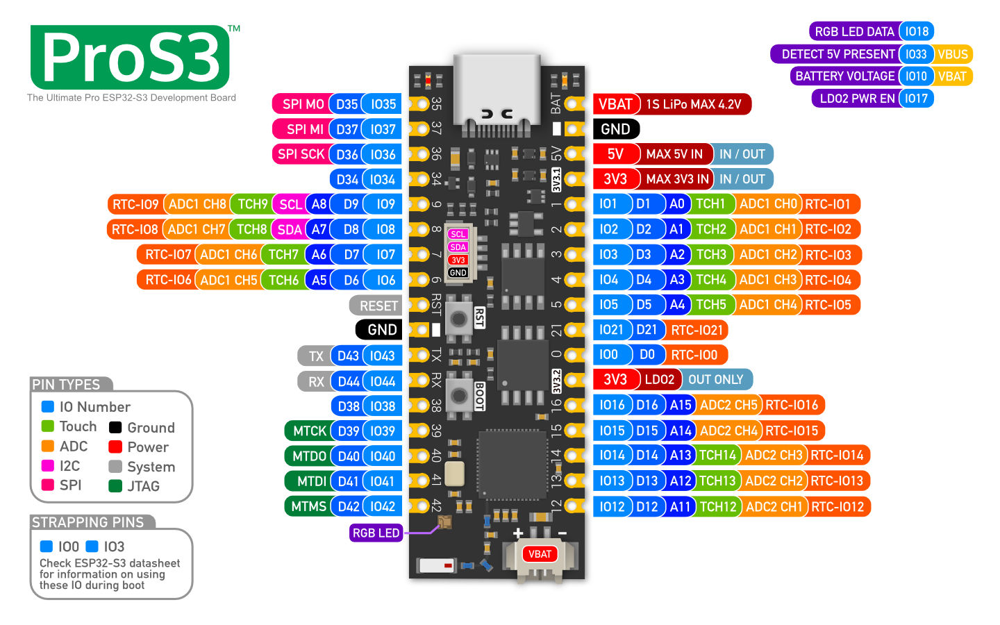

# SpectraFrame

A battery powered, WiFi-enabled Spectra6 color E-Paper display frame with web configuration, image upload UI, and more.

## Features

- **Color E-Paper Display:** Utilizes a 1600 x 1200, 13.3inch Spectra6 E-Paper display for high-resolution, low-power image display.
- **Web Configuration:** Provides a simple web interface for initial WiFi setup and device configuration.
- **Image Upload:** Allows users to tweak, preview and upload images via the web interface.
- **Over-The-Air (OTA) Updates:** Supports wireless firmware and filesystem updates directly from the web interface.
- **Automatic Hibernation:** SpectraFrame basically deep sleeps all the time, until you wake it up manually when you're ready to change the picture.
- **Touch Wakeup:** Wakes from deep sleep via a touch sensor.
- **LED Status Indicator:** An RGB LED provides visual feedback on the device's state (connecting, busy, idle, error, etc.).

## Hardware

- **Waveshare Spectra6 13.3inch E-Paper with Driver Board:** The bundle version comes with a driver board, which handles the SPI communication and power management for the display. This board connects to the microcontroller via SPI and GPIO pins.
- **ProS3 Microcontroller:** The core processing unit. The code is developed for the [Unexpected Maker ProS3](https://esp32s3.com/pros3.html), an ESP32-S3 based board featuring 16MB Flash, 8MB PSRAM, built-in LiPo charging with PicoBlade connector, and ultra-low deep sleep current. The ProS3's onboard RGB LED uses GPIO 18.
- **Power Supply:** A LiPo battery can be connected directly to the ProS3's PicoBlade battery connector for integrated charging and power management. Alternatively, a 3.2V LiFePO4 battery cell can be connected directly to the 3v3 and GND pins thanks to its compatible voltage range (add a Schottky diode to protect from wrong polarity). 
- **Touch Sensor:** It is used to wake up the device from hibernation prior to uploading a new image. I used a piece of wide copper tape and adjusted sensitivity in the code so it could be triggered through the glass and passe-partout.

### Assembly

- I picked up a generic 40×30 cm wooden frame and 27×20 cm ish passe-partout from my local DIY store. The display is 270.4×202.8 mm and I might get a better fitting passe-partout
- The display and ESP are secured on a 40×30 cm, 6mm thick MDF board that was laser cut with [this svg template](doc/lasercut.svg) (blue lines for mark and red for cut)
- The display is locked onto the MDF board with custom 3d printed clamps ([STL](doc/clamp.stl), [STEP](doc/clamp.step)), clamps can be tightened with 2×5mm flathead wood screws into laser cut preholes.
- The ESP was hotglued yay
- I initially used a 18500 LiFePO4 battery cell as power source, and 3D printed battery holder remixed from [this 18650 model](https://www.thingiverse.com/thing:456900). I have since replaced it with a 2000mAh LiPo battery connected to the ProS3's PicoBlade battery connector.

### Wiring

#### E-Paper display

| e-Paper Pin | Cable color | ESP32 Pin | Notes |
|---|---|---|---|
| VCC | Red | 3.3V | Power supply voltage. |
| GND | Black | GND | Common ground.. |
| DIN | Blue | GPIO 35 (MOSI) | SPI Data line from ESP32 to the display. |
| CLK | Yellow | GPIO 36 (SCLK) | Clock line of the SPI bus. |
| CS_M | Orange | GPIO 34 | Chip Select for the display driver board. |
| CS_S | Green | GPIO 9 | Chip Select for the built in flash storage. |
| DC | White | GPIO 8 | Data/Command select. |
| RST | Purple | GPIO 7 | Display reset. |
| BUSY | Brown | GPIO 6 | Busy status from display to ESP32. Needs to be an input. |
| PWR | Grey | GPIO 5 | Display power control. |

#### Other

- LiFePO battery powers the ESP32 directly on its 3v3 pin.
- A copper tape is wired to GPIO 4 to act as a touch sensor
- A high impedance voltage divider is set up and read on GPIO 14 to monitor the battery level. I used 150kΩ (R1) and 1MΩ (R2) resistors.

#### Notes

- The ProS3's onboard RGB LED is on GPIO 18 (see pinout reference below)
- The ProS3 has ultra-low deep sleep current, making it ideal for battery-powered operation
- GPIO4 should be connected to some kind of capacitive sensor (a strip of copper tape in my case)

### Reference pinouts

ProS3 pinout (recommended)

 
The ProS3 is the recommended board for this project. It features an onboard RGB LED on GPIO 18, LiPo charging via PicoBlade connector, VBAT sense pin, and ultra-low deep sleep current.
  

[source](https://esp32s3.com/pros3.html) - [schematic & resources](https://github.com/unexpectedmaker/esp32s3)

 

ESP32-S3-DevKitC-1 pinout (alternative)

 

[source](https://docs.espressif.com/projects/esp-dev-kits/en/latest/esp32s3/esp32-s3-devkitc-1/user_guide.html#hardware-reference)

 

YD-ESP32-S3 clone pinout (alternative)

 
This clone was used in earlier iterations. The onboard RGB LED is wired to GPIO 48.
  

[source](https://mischianti.org/vcc-gnd-studio-yd-esp32-s3-devkitc-1-clone-high-resolution-pinout-and-specs/) - [additional info](https://github.com/rtek1000/YD-ESP32-23)

## Architecture

The software is structured around a main loop (`main.cpp`) and several manager classes, following an object-oriented approach to organize different functionalities.

- **`main.cpp`:** Contains the core application setup (`setup()`) and main loop (`loop()`). It initializes peripherals, sets up WiFi (as either a STA or AP), starts the web server, manages the main application flow, handles touch input, and triggers hibernation. It orchestrates the interactions between the manager classes.
- **`DisplayManager`:** Encapsulates all interactions with the E-Paper display hardware. It manages the display buffer, handles drawing operations (text, shapes, QR codes), and controls the display update and sleep cycles (`EPD_13IN3E_Init`, `EPD_13IN3E_Display`, `EPD_13IN3E_Sleep`). It also manages the state of what is currently shown on the display and persists this state across deep sleep cycles using `RTC_DATA_ATTR`.
- **`HibernationManager`:** Manages the device's power-saving features. It tracks inactivity based on calls to `resetActivityTimer()`. When the inactivity timeout is reached, it triggers the deep sleep sequence by calling display sleep functions (`EPD_13IN3E_Sleep`, `DEV_Module_Exit`) and then initiating ESP32 deep sleep (`esp_deep_sleep_start`). It can be paused and resumed by other parts of the application (like during OTA or display updates).
- **`OtaManager`:** Handles Over-The-Air firmware and filesystem updates. It provides the web server handler for `/api/update` and manages the `Update` process provided by the ESP32 core. It pauses hibernation during the update process and signals the LedManager for status feedback.
- **`LedManager`:** Manages the ProS3 onboard RGB LED status indicator. It uses the `neopixelWrite` function and provides a simple interface (`setMode()`, `update()`) to control the LED color and animation based on the application's state (busy, idle, error, AP mode, etc.). It also manages the ProS3's LDO2 power rail to enable the LED.
- **Web Server (`ESPAsyncWebServer`):** Handles incoming HTTP requests for serving the web UI, receiving configuration data, and accepting file uploads (images and OTA updates).
- **DNS Server (`DNSServer`):** Used in AP mode to implement a captive portal, redirecting all DNS requests to the ESP32's IP address to ensure users are directed to the configuration web page.
- **LittleFS:** The filesystem used to store the web UI files (`index.html`, `style.css`, `js/`) and the uploaded image file (`/image.bin`).
- **DEV_Config:** Low-level hardware configuration and SPI communication functions for the E-Paper display, provided by the Waveshare library.

## User Manual

1.  **Initial Setup (AP Mode):**
    - Power on the SpectraFrame.
    - If no WiFi credentials are saved, the device will automatically start in Access Point (AP) mode.
    - The E-Paper display will show a QR code containing the AP SSID (`SpectraFrameSetup`) and password (`spectra1234`). The LED will pulse green slowly.
    - Connect your phone or computer to this WiFi network.
    - A captive portal should automatically redirect you to the configuration web page. If not, open a web browser and navigate to `http://192.168.4.1`.

2.  **Configuring WiFi (STA Mode):**
    - On the configuration web page, enter your home/office WiFi SSID and password.
    - Click "Save Configuration".
    - The device will save the credentials and reboot.
    - If the connection is successful, the device will connect to your WiFi network. The LED will pulse red slowly when idle.
    - If connection fails after reboot, it will revert to AP mode.

3.  **Accessing the Web Interface (STA Mode):**
    - Once connected to your WiFi, the device's IP address will be displayed as a QR code on the E-Paper display (pulse red LED when idle).
    - Scan the QR code or type the IP address into a web browser on a device connected to the *same* network.
    - This will open the web interface where you can upload images and perform OTA updates.
    - Touching the bottom right corner of the E-Paper display will also show the IP QR code temporarily.

4.  **Uploading an Image:**
    - In the web interface, navigate to the image upload section.
    - Select an image file. The web interface includes client-side JavaScript (`image-processor.js`) to resize and convert images to the correct 4bpp format (1200x1600 pixels, 4 colors: Black, White, Red, Yellow, Blue, Green).
    - Click "Upload".
    - The image will be uploaded to the device's internal storage (`/image.bin`).
    - Upon successful upload, the new image will be displayed on the E-Paper, and the activity timer will be reset. The LED will pulse green fast for 2 seconds before the refresh, then turn off during the update, and finally return to pulsing red slowly.

5.  **Over-The-Air (OTA) Updates:**
    - In the web interface, navigate to the OTA update section.
    - Choose whether to update the "Firmware" or "Filesystem".
    - Select the appropriate `.bin` file (either the firmware binary or a LittleFS image).
    - Click "Upload".
    - The device will receive the update. The LED will pulse red fast during the upload.
    - Upon successful upload, the device will automatically reboot to apply the update. The LED will turn static green before rebooting.
    - If the update fails, the LED will turn static red, and an error message will be shown in the web interface.

6.  **Hibernation:**
    - After 5 minutes of inactivity (no touch, no web requests, no image display), the device will automatically enter deep sleep mode to save power.
    - The E-Paper display will show a message indicating it's sleeping, or revert to the last displayed image if one was set. The LED will turn off.
    - To wake the device, touch the glass extending at the bottom of the E-Paper display (or wherever the capacitive sensor has been installed).

7.  **LED Status Indicators:**
    - **Off:** Deep sleep mode or during active display refresh.
    - **Pulsing Green (Slow):** AP Mode (waiting for configuration).
    - **Pulsing Green (Fast):** Display update initiated (first 2 seconds).
    - **Pulsing Red (Slow):** STA Mode, Idle (connected to WiFi, waiting for interaction).
    - **Pulsing Red (Fast):** Busy (performing an operation like file upload, or busy during OTA).
    - **Static Green:** OTA Update successful (briefly before reboot).
    - **Static Red:** Error occurred (e.g., failed to mount filesystem, failed OTA).

## Building

This is a PlatformIO project: simply load it, adapt `platformio.ini` to your specific board, and `pio run` or `pio run -t upload`

## Deploying the filesystem image

To build the filesystem image in VS Code, go to PlatformIO panel and run Project Tasks > Build Filesystem Image

To flash it:
- from VS Code: kill all terminals or anything possibly keeping the COM port busy, then in PlatformIO panel, run Project Tasks > Upload Filesystem Image.
- or upload using OTA, by selecting Filesystem and picking littlefs.bin.

## TODO

- Add battery monitoring
- Add a simple automation/polling system, maybe similar to [this project](https://github.com/Hilko113/epaper_imageclient_spectra6)

## Credits & dependencies

This project is made possible by:

- Waveshare 13.3" Spectra6 E-Paper display [documentation](https://www.waveshare.com/wiki/13.3inch_e-Paper_HAT+_(E)_Manual) 
- Web UI dithering tool was inspired from https://www.e-paper-display.com/dithering.html by Zhang Hui
- Sources redistributed in this repository:
    - Waveshare driver code from https://files.waveshare.com/wiki/13.3inch%20e-Paper%20HAT%2B/13.3inch_e-Paper_E.zip (`DEV_Config.*`, `EPD_13in3e.*`, `GUI_Paint.*`, `fonts.*`) - with small tweaks
    *  [QR Code generator](https://github.com/nayuki/QR-Code-generator) (`qrcodegen.hpp`) by Nayuki
- Dependencies managed from ` platformio.ini`:
    - [ESPAsyncWebServer](https://github.com/ESP32Async/ESPAsyncWebServer)
    - [ArduinoJson](https://github.com/bblanchon/ArduinoJson) by Benjamin Blanchon
